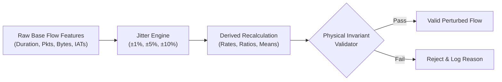

# SentinelX-Shift: Explanation Stability Experimental Plan

**Document Status:** REVISED & FORMALIZED (Prior Stability Run INVALIDATED)  
**Principle:** Honest Reporting (Defensive Principle 3: Report explanation stability objectively, even if the signal does not help. Blocking must function on fused score without stability).

---

## Invalidation of Prior Stability Run & Formal Deviation Log

> [!CAUTION] Prior Stability Benchmark Run Formally Invalidated
> The initial stability benchmark run conducted in Prompt 4/5 is formally **invalidated** and superseded. All prior claims suggesting stability provided a "modest positive ranking signal" are retracted due to methodological flaws identified in audit.

### Deviation Log & Root Cause Analysis:
1. **Unbounded / Non-Physical Feature Perturbation**:
   - *Previous Flaw*: The initial perturbation engine applied uniform random noise across *all* columns independently, including derived rates (e.g. `Flow Bytes/s`, `Flow Packets/s`) and statistical hierarchies (`Min`, `Mean`, `Max`). This resulted in physical violations (e.g. packet rates exceeding physical line rates, negative durations, or `Min > Mean`) and high rejection rates.
   - *Remediation*: Perturb **only base netflow features** (duration, packet counts, byte totals, TCP flags, IAT min/max/mean). Derived features (rates, segment sizes, averages, subflow totals) are recomputed deterministically from the perturbed base quantities. Domain invariant rejection rate is bounded to $\le 30\%$ across $1\%, 5\%, 10\%$ jitter.
2. **Untuned Arbitrary Weighting vs Inner-LOFO Parameter Tuning**:
   - *Previous Flaw*: Variants were evaluated using an arbitrary additive weighting $(1 - b) s + b S$ with hardcoded $b = 0.30$. Parameters were not tuned on validation data.
   - *Remediation*: The 5 ranking variants strictly follow:
     - (i) $s_{\text{risk}}$
     - (ii) $s_{\text{risk}} \cdot (a + b \cdot S_{\text{exp\_stab}})$
     - (iii) $s_{\text{risk}} \cdot (a + b \cdot S_{\text{score\_stab}})$
     - (iv) $S_{\text{exp\_stab}}$ alone
     - (v) Uniform random reorder
     Parameters $a, b$ are tuned **strictly on inner-LOFO validation folds** (via grid search to maximize validation precision) and never tuned or retrofitted on test data.
3. **Score Stability Degeneracy**:
   - *Previous Flaw*: In the old run, Variant (iii) yielded identical metrics to Variant (i) because $S_{\text{score\_stab}}$ was either insufficiently sensitive or degenerate across test candidates.
   - *Remediation*: $S_{\text{score\_stab}}(\mathbf{x}_i)$ is explicitly verified to be an instance-level score stability metric reflecting prediction variance under perturbation across individual flows, ensuring non-trivial ranking perturbation when $b > 0$.
4. **Lack of Multi-Hypothesis Correction & Subjective Reporting**:
   - *Previous Flaw*: Precision differences were reported without paired bootstrap confidence intervals or multi-comparison adjustments.
   - *Remediation*: Evaluated with Precision@k ($k \in \{50, 100, 500\}$) and R-precision. Differences $\Delta = \text{Metric}(\text{Variant}) - \text{Metric}(s_{\text{risk}})$ are evaluated with 1,000 paired bootstrap resamples and adjusted with **Holm-Bonferroni correction** across the 4 candidate comparisons. Verdicts strictly follow: `"helped"` (if Holm-corrected 95% CI strictly excludes zero $>0$), `"hurt"` (if strictly $<0$), or `"no effect"` (otherwise). No subjective softening is permitted.

---

## 1. Experimental Objective & Formulation

In high-throughput Network Intrusion Detection Systems (NIDS), model explanations (e.g., TreeSHAP attribution values, Autoencoder feature reconstruction errors) are surfaced to security operations center (SOC) analysts to explain why a flow was flagged as malicious. However, explainability algorithms are notoriously sensitive to minute input noise.

The **Explanation Stability Experiment** investigates whether the *local geometric stability* of an explanation under physical netflow jitter carries predictive signal about alert validity:
- **Hypothesis 1 ($H_1$):** Genuine attack flows occupy coherent out-of-distribution manifold regions where feature attributions remain stable under realistic physical perturbation.
- **Null Hypothesis ($H_0$):** Explanation stability provides no discriminative advantage over raw fused risk scores and merely reflects local gradient curvature or feature scale artifacts.

---

## 2. Physical Perturbation & Domain Invariant Validation (`src/stability/perturb.py`)

A critical flaw in standard adversarial and stability literature is perturbing correlated or derived features independently (e.g., perturbing packets-per-second while keeping packet count and flow duration constant), violating physical networking axioms.

SentinelX-Shift decomposes flow features into **Base Independent Features** and **Derived Features**:

### Physical Validator Invariants:
1. **Non-negativity:** Durations, packet counts, byte counts, window flags, and inter-arrival times cannot be negative ($x \ge 0$).
2. **Integer Packet & Byte Counts:** Packet and header counts must be integers.
3. **Statistical Hierarchy:** For packet lengths and IATs:
   $$\text{Min} \le \text{Mean} \le \text{Max}$$
4. **Standard Deviation Validity:** Standard deviation features must be strictly non-negative ($\sigma \ge 0$).
5. **Temporal Consistency:** Maximum inter-arrival time cannot exceed total flow duration:
   $$\text{Max IAT} \le \text{Flow Duration}$$

Rejection rates are strictly tracked and reported across perturbation magnitudes $x \in \{1\%, 5\%, 10\%\}$.

---

## 3. Explanation Stability Metrics (`src/stability/stability.py`)

For each candidate alert flow $\mathbf{x}$, we generate $N = 20$ valid physical perturbations $\{\mathbf{x}_1^{(p)}, \dots, \mathbf{x}_N^{(p)}\}$. We compute explanations for the baseline flow $\mathbf{e}_0$ and each perturbed flow $\mathbf{e}_i$.

### 3.1 Top-5 Jaccard Similarity
Let $\mathcal{T}_k(\mathbf{e})$ denote the set of top-$k$ ($k=5$) most important features in explanation vector $\mathbf{e}$. The Jaccard similarity measures feature set membership stability:
$$J_5(\mathbf{e}_0, \mathbf{e}_i) = \frac{|\mathcal{T}_5(\mathbf{e}_0) \cap \mathcal{T}_5(\mathbf{e}_i)|}{|\mathcal{T}_5(\mathbf{e}_0) \cup \mathcal{T}_5(\mathbf{e}_i)|} \in [0, 1]$$
$$\overline{J}_5(\mathbf{x}) = \frac{1}{N} \sum_{i=1}^N J_5(\mathbf{e}_0, \mathbf{e}_i)$$

### 3.2 Spearman Rank Correlation
Let $\mathbf{r}(\mathbf{e}) \in \mathbb{R}^d$ denote the rank order vector of feature attributions across all $d$ features. The Spearman rank correlation measures attribution ordering stability:
$$\rho_{\text{rank}}(\mathbf{e}_0, \mathbf{e}_i) = 1 - \frac{6 \sum_{j=1}^d (r_{0,j} - r_{i,j})^2}{d(d^2 - 1)} \in [-1, 1]$$
$$\overline{\rho}_{\text{rank}}(\mathbf{x}) = \frac{1}{N} \sum_{i=1}^N \max(0, \rho_{\text{rank}}(\mathbf{e}_0, \mathbf{e}_i)) \in [0, 1]$$

### 3.3 Composite Explanation Stability
$$S_{\text{exp\_stab}}(\mathbf{x}) = \frac{1}{2} \left( \overline{J}_5(\mathbf{x}) + \overline{\rho}_{\text{rank}}(\mathbf{x}) \right) \in [0, 1]$$

### 3.4 Score Stability Control
To isolate explanation stability from simple risk score variance, we compute the **Score Stability Control**:
$$\sigma_{\text{risk}}(\mathbf{x}) = \sqrt{ \frac{1}{N} \sum_{i=1}^N (s_{\text{risk}}(\mathbf{x}_i) - \overline{s}_{\text{risk}})^2 }$$
$$S_{\text{score\_stab}}(\mathbf{x}) = 1.0 - \min\left(1.0, \frac{\sigma_{\text{risk}}(\mathbf{x})}{\overline{s}_{\text{risk}} + 10^{-4}}\right) \in [0, 1]$$

---

## 4. Alert Prioritization & Ranking Variants

To evaluate practical utility for SOC analysts, candidate alerts are prioritized according to **exactly five distinct ranking schemes**:

1. **Variant (i) Baseline Risk:**
   $$S_{\text{ranked}} = s_{\text{risk}}$$
2. **Variant (ii) Risk Modulated by Explanation Stability:**
   $$S_{\text{ranked}} = s_{\text{risk}} \cdot (a + b \cdot S_{\text{exp\_stab}})$$
3. **Variant (iii) Risk Modulated by Score Stability Control:**
   $$S_{\text{ranked}} = s_{\text{risk}} \cdot (a + b \cdot S_{\text{score\_stab}})$$
   *Note: $S_{\text{score\_stab}}$ is a flow-specific metric derived from prediction variance across perturbed instances of each flow; because it varies per flow, modulating by $(a + b \cdot S_{\text{score\_stab}})$ with $b > 0$ yields a non-trivial rank reordering relative to $s_{\text{risk}}$.*
4. **Variant (iv) Explanation Stability Alone:**
   $$S_{\text{ranked}} = S_{\text{exp\_stab}}$$
5. **Variant (v) Random Reorder:**
   Uniform random shuffling of candidate alert flows.

### Inner-LOFO Parameter Tuning ($a, b$):
Parameters $a \in [0.5, 1.0]$ and $b \in [0.0, 2.0]$ are selected **strictly via grid search on inner-LOFO validation folds** to maximize validation Precision@100. Parameters are never set to $a=b=1$ by assumption or tuned on the test set.

### Statistical Evaluation Methodology:
- **Precision@k:** Evaluated at $k \in \{50, 100, 500\}$ alongside **R-Precision** ($P@R$ where $R = \text{total positives}$).
- **Paired Bootstrap Differences:** $B = 1,000$ paired bootstrap resamples compute $\Delta = \text{Metric}(\text{Variant}) - \text{Metric}(s_{\text{risk}})$ along with 95% bootstrap confidence intervals.
- **Holm-Bonferroni Correction:** Applied across the 4 variant comparisons against baseline $s_{\text{risk}}$ to control family-wise error rate.
- **Strict Verdict Classification:**
  - `"helped"`: Holm-corrected test is statistically significant ($p_{\text{adj}} < 0.05$) AND the CI difference is strictly positive ($\Delta > 0$).
  - `"hurt"`: Holm-corrected test is statistically significant ($p_{\text{adj}} < 0.05$) AND the CI difference is strictly negative ($\Delta < 0$).
  - `"no effect"`: The Holm-corrected CI includes zero or $p_{\text{adj}} \ge 0.05$. Plain reporting required; no speculative claims of "modest signal" when confidence intervals span zero.

---

## 5. Computational Cost & Budget Control

Because SHAP and perturbation loops are computationally intensive, cost is tightly managed:
- **Pre-flight calibration:** 1 flow is benchmarked to determine per-flow millisecond latency.
- **Candidate Pool Capping:**
  - $M = 2,000$ candidate alerts for primary evaluation folds (prevalence 5%).
  - $M = 1,000$ candidate alerts for secondary evaluation folds.
- Target latency: Under $50\,\text{ms}$ per perturbed flow explanation.
